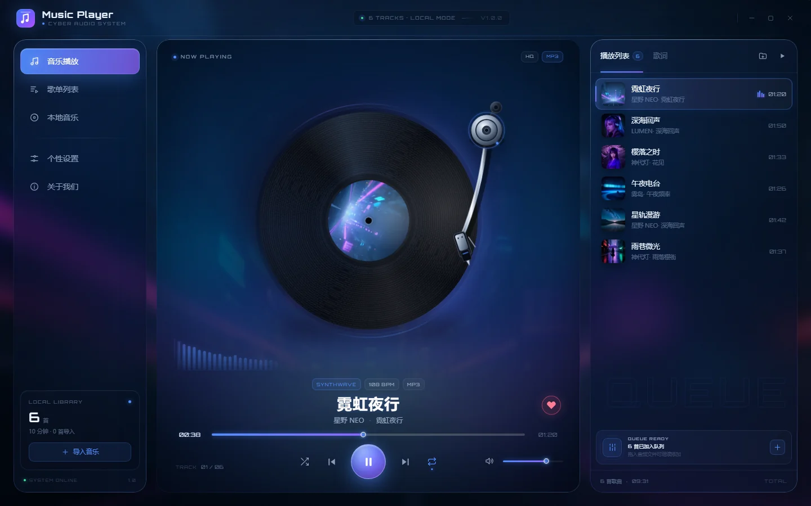
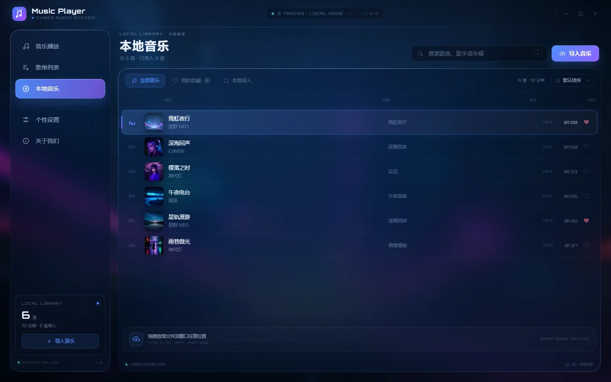
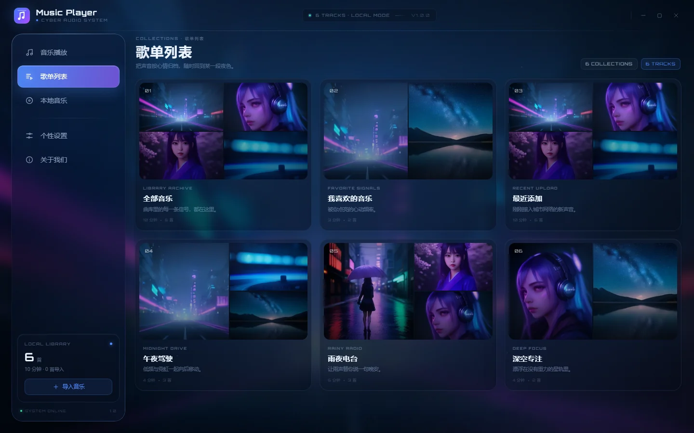
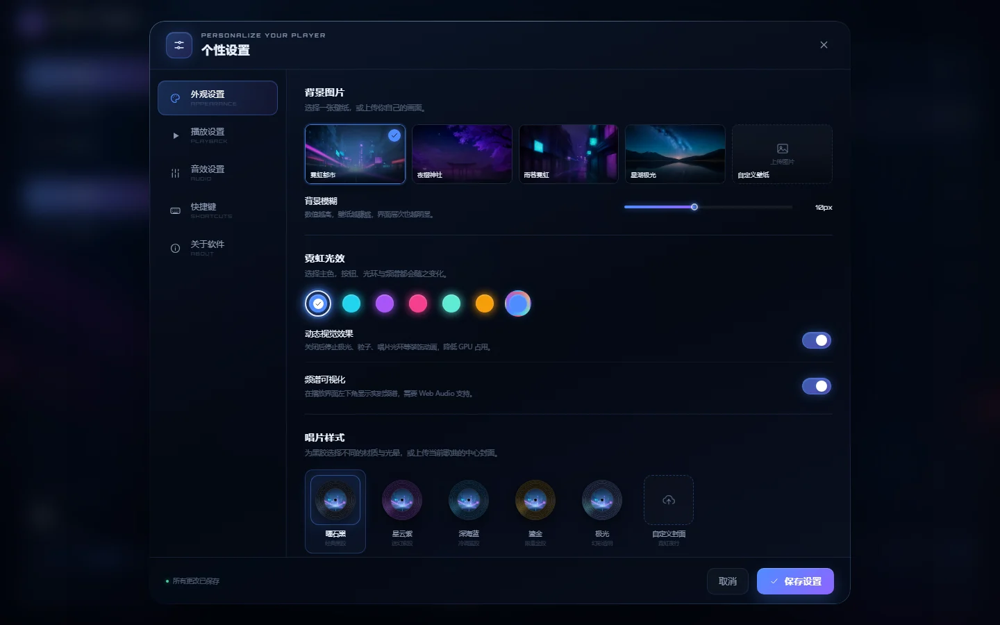

<div align="center">
  
  <h1>Music Player · Cyber Audio</h1>
  <p><strong>赛博朋克暗黑玻璃拟态 · 本地音乐播放器 · 纯前端 · 完全离线</strong></p>
</div>



深海蓝与霓虹紫交织的桌面级音乐播放器。真实质感的黑胶唱片与金属唱针、可实时切换的壁纸与霓虹主题、本地曲库与歌词同步——无需账号、无需后端，音乐和设置都留在你自己的电脑上。

## 界面预览

| 本地音乐 | 歌单列表 |
| --- | --- |
|  |  |

| 个性设置 | 主题色实时切换 |
| --- | --- |
|  | 霓虹主色可在设置中任意选择，按钮、光环、频谱与黑胶光晕会整体联动。 |

## 功能特性

### 核心播放

- 黑胶唱片：CSS 绘制同心圆沟槽、高光反射与霓虹光环，播放时旋转、暂停时定格
- 金属唱针：播放时落向唱片、暂停时抬起，带阻尼过渡
- 实时频谱可视化（Web Audio AnalyserNode），随音乐律动
- 当前歌曲封面自动作为环境光晕与背景氛围色
- 播放 / 暂停、上一首 / 下一首、拖拽进度、音量、静音
- 随机播放、顺序播放、列表循环、单曲循环
- Media Session API：支持系统媒体键与系统媒体面板
- 迷你播放器：最小化后保留为桌面角落的悬浮播放条

### 本地音乐管理

- 一键选择文件，或把音频直接拖入窗口任意位置
- 支持 MP3 / FLAC / WAV / M4A / AAC / OGG / Opus / WebM
- 零依赖读取 **ID3v2.2 / v2.3 / v2.4** 与 **FLAC** 标签：标题、歌手、专辑、年份、内嵌封面
- IndexedDB 持久化：导入的音频、封面、元数据在刷新或重启后自动恢复
- 搜索、收藏、按全部 / 收藏 / 本地导入筛选，按最近添加 / 名称 / 时长排序
- 移除本地歌曲时同步清理存储与对象 URL

### 歌词

- 内置示例曲目的原创 LRC 歌词，按播放进度自动滚动、高亮当前行
- 用户滚动歌词时暂停自动跟随，并提供「跟随歌词」按钮
- 本地导入歌曲没有歌词时，展示优雅的空状态而不是报错

### 个性化设置

- 4 套内置赛博朋克壁纸 + 自定义壁纸上传（自动压缩并本地保存）
- 背景模糊 0–24 px 可调
- 6 种霓虹主色 + 任意自定义颜色，主题实时联动
- 5 种黑胶材质：曜石黑 / 星云紫 / 深海蓝 / 鎏金 / 极光
- 自定义当前歌曲的唱片中心封面，按歌曲记忆
- 动态视觉效果开关（极光、粒子、唱片光环）与频谱可视化开关
- 三段 Web Audio 均衡器（低频 / 中频 / 高频），含 6 组预设与曲线预览
- 播放完成行为、启动恢复、播放音量、循环方式、随机播放
- 快捷键说明与关于页面

## 技术栈

| 分类 | 选型 |
| --- | --- |
| 框架 | Vue 3.5（`<script setup>` 组合式 API） |
| 构建 | Vite 8 · 原生 CSS（无 UI 框架依赖） |
| 状态 | Pinia（setup stores） |
| 路由 | Vue Router 5（Hash 模式，适配 `file://`） |
| 工具 | VueUse |
| 音频 | HTMLAudioElement + Web Audio API（增益、三段均衡、频谱） |
| 存储 | localStorage（偏好） + IndexedDB（音频文件与封面） |
| 主题 | CSS Custom Properties + `useTheme` 响应式注入 |

## 快速开始

要求 **Node.js 22+**（Vite 8 的运行要求）。

```bash
npm install
npm run dev        # 开发服务器
npm run build      # 生产构建，输出 dist/
npm run preview    # 预览生产构建
```

打开终端里输出的本地地址即可。默认开发地址为 `http://127.0.0.1:5173`；若端口被占用 Vite 会自动顺延。

## 键盘快捷键

| 按键 | 功能 |
| --- | --- |
| `Space` | 播放 / 暂停 |
| `N` / `P` | 下一首 / 上一首 |
| `←` / `→` | 快退 / 快进 5 秒 |
| `Shift + ← / →` | 快退 / 快进 15 秒 |
| `↑` / `↓` | 音量 ±5% |
| `M` | 静音 / 取消静音 |
| `S` | 随机播放开关 |
| `R` | 切换循环模式 |
| `L` | 收藏当前歌曲 |
| `/` | 聚焦本地音乐搜索框 |
| `Esc` | 关闭当前面板 / 弹窗 |

## 工程结构

```text
music-player/
├─ docs/                     # README 预览图
├─ public/
│  ├─ audio/                 # 6 首原创示例音乐（MP3）
│  ├─ covers/                # 示例封面
│  ├─ wallpapers/            # 内置壁纸
│  └─ favicon.svg
├─ scripts/
│  ├─ generate_assets.py     # 开发期素材生成与后期处理
│  ├─ generate_demo_audio.py # numpy + LAME 合成示例音乐
│  └─ audio-manifest.json    # 示例音乐时长清单
├─ src/
│  ├─ core/audioEngine.js    # 音频元素 + Web Audio 图
│  ├─ stores/
│  │  ├─ player.js           # 播放状态机、队列、Media Session
│  │  ├─ library.js          # 曲库、导入、IndexedDB 持久化
│  │  ├─ settings.js         # 主题 / 外观 / 音效偏好
│  │  └─ ui.js               # 弹窗、Toast、迷你播放器
│  ├─ composables/           # 主题、拖拽导入、快捷键、文件选择
│  ├─ components/
│  │  ├─ common/             # 图标、封面、滑杆、开关、弹窗、Toast
│  │  ├─ layout/             # 标题栏、侧栏、背景、粒子、迷你播放器
│  │  ├─ player/             # 黑胶、唱针、频谱、进度、队列、歌词
│  │  ├─ playlist/           # 歌单卡片与拼贴封面
│  │  ├─ settings/           # 设置窗口、均衡器曲线、黑胶缩略图
│  │  └─ about/
│  ├─ views/                 # 音乐播放 / 歌单列表 / 本地音乐
│  ├─ data/                  # 示例曲目、LRC 歌词、预设数据
│  ├─ utils/                 # 格式化、颜色、ID3/FLAC、IndexedDB、LRC
│  └─ styles/                # 设计令牌、基础样式、玻璃拟态、动画
├─ index.html
├─ vite.config.js
└─ package.json
```

## 数据与隐私

所有数据都保存在本机，不发起任何业务网络请求（字体与示例素材均已本地打包）。

| 位置 | Key / Store | 内容 |
| --- | --- | --- |
| localStorage | `cyber-player:settings-v1` | 壁纸、模糊、霓虹色、黑胶皮肤、均衡器、播放偏好 |
| localStorage | `cyber-player:volume-v1` / `muted-v1` | 音量与静音状态 |
| localStorage | `cyber-player:last-playback-v1` | 上次歌曲与播放进度 |
| localStorage | `cyber-player:favorites-v1` | 收藏的歌曲 id |
| IndexedDB | `cyber-music-player` / `tracks` | 导入音频 Blob、封面 Blob、元数据 |

> 无账号、无后端、无遥测。清除浏览器站点数据即可彻底删除所有本地记录。

## 打包为桌面应用

项目已为桌面打包做好两项准备：

1. `vite.config.js` 中构建模式使用 `base: './'`，产物可从 `file://` 直接加载；
2. 路由使用 Hash 模式，不依赖服务器 history 回退。

`npm run build` 之后，`dist/` 即为可交付的静态应用。以 Electron 为例：

```js
// electron/main.cjs
const { app, BrowserWindow } = require('electron')
const path = require('node:path')

function createWindow() {
  const win = new BrowserWindow({
    width: 1440,
    height: 900,
    minWidth: 1024,
    minHeight: 660,
    backgroundColor: '#03060f',
    titleBarStyle: 'hidden',
    frame: false,
    webPreferences: {
      contextIsolation: true,
      nodeIntegration: false,
      preload: path.join(__dirname, 'preload.cjs'),
    },
  })
  win.loadFile(path.join(__dirname, '..', 'dist', 'index.html'))
}

app.whenReady().then(createWindow)
```

- 现有标题栏已经包含拖拽区域（`-webkit-app-region: drag`）与窗口控制按钮。接入 Electron 后，把 `WindowControls.vue` 里的最小化 / 全屏 / 关闭改为 IPC 调用即可（当前网页版分别实现了迷你播放器、全屏 API 与关闭页）。
- 使用 `electron-builder` 或 `electron-forge` 打包 exe；记得把 `dist/`、`public/` 产物一并纳入 `files`。
- Tauri 同样适用：让 `tauri.conf.json` 的前端目录指向 `dist`，并使用 hash 路由。

## 资源说明

- **示例音乐**：`scripts/generate_demo_audio.py` 使用 numpy 从零合成，再经 LAME 编码为 MP3；旋律、和弦与氛围均为本项目原创，无第三方录音或采样。
- **示例视觉**：`scripts/generate_assets.py` 调用文本生成图片服务（Pollinations）生成原始画面，并在本地完成裁切、调色、暗角、颗粒与 WebP 压缩。图片仅用于本项目的演示内容。
- **字体**：Orbitron（SIL Open Font License），已本地打包，运行时不请求 Google Fonts。
- 如需商用或再分发，请自行确认生成服务条款，并替换为你拥有权利的音乐与图片。

## 浏览器支持与已知限制

- 推荐 Chromium 110+（Chrome / Edge）。Firefox、Safari 可运行，但 Web Audio 与部分音频编码支持存在差异。
- 浏览器无法解码的编码（如 APE、WMA）不会被导入；导入时会在 Toast 中提示。
- `file://` 或极端隐私模式下 Web Audio / IndexedDB 可能受限：均衡器会自动旁路，曲库会退化为仅本次会话可用。
- 本地音乐元数据读取为尽力而为：异常或非标准标签不会被破坏性处理，标题会回退到文件名。
- 歌词仅内置在示例曲目中；本地导入曲目暂不解析同目录 `.lrc` 文件。

## License

本项目代码可自由使用与修改。示例音频与图片仅用于本项目的界面演示，请替换为你拥有权利的内容后再分发。
